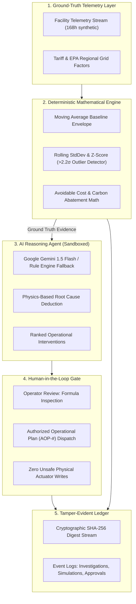

# ImpactOps AI — Sustainable Operations Intelligence & Autonomous Decision Agent

> **Hackathon Theme:** Build Beyond AI: Engineer Secure, Intelligent and Autonomous Applications  
> **Status:** Production-Ready Architecture & Local Verifiable Prototype  
> **Stack:** TypeScript, React 19, Vite, Express, Google Gemini 1.5 Flash, Google Stitch MCP Design Tokens

[](#automated-validation)
[](LICENSE)
[](#google-technologies)
[](#security-engineering)

---

## 🌍 The Problem

Industrial manufacturing plants, hyperscale data centers, and corporate facilities waste millions of dollars and emit thousands of metric tons of avoidable greenhouse gases annually because:
1. **Telemetry is fragmented** across isolated building management systems (BMS), SCADA loops, and sub-meters.
2. **Inefficiencies are invisible** — subtle mechanical faults (like stuck bypass valves or chiller resonance locks) operate unflagged for weeks.
3. **Interventions lack prioritization** — maintenance teams cannot calculate financial ROI, payback periods, or carbon trade-offs on the fly.
4. **Autonomous AI is treated with skepticism** — facilities managers cannot trust black-box LLMs that make unverified claims or execute unauthorized hardware changes.

---

## ⚡ The Solution: ImpactOps AI

**ImpactOps AI** is an operational intelligence and autonomous decision agent that converts raw telemetry into explainable, verified, human-authorized sustainability interventions:

1. **Continuous Anomaly Detection**: Ingests multi-day streaming telemetry (electricity kWh, water kL, waste tons) and detects deviations using rolling standard deviations and statistical z-scores ($z > 2.2\sigma$).
2. **Autonomous Multi-Stage Investigation**: Moves through transparent reasoning stages:
   $$\text{OBSERVE} \longrightarrow \text{DETECT} \longrightarrow \text{REASON} \longrightarrow \text{SYNTHESIZE} \longrightarrow \text{RECOMMEND} \longrightarrow \text{APPROVAL GATE}$$
3. **Dual AI Reasoning Engine**: Powered by **Google Gemini 1.5 Flash** with an automatic, transparent **Deterministic Mathematical Rule Engine fallback** that ensures 100% functionality even without API keys.
4. **Transparent Mathematical Payback**: Every recommendation shows its exact algebraic formula, tariff inputs, and payback timeline.
5. **Human-in-the-Loop Governance**: Enforces a strict approval gate. Approved actions are dispatched as formal **Authorized Operational Plans (AOP)** rather than unsafe physical actuator writes.
6. **Scenario Simulator**: Side-by-side interactive modeling of HVAC setback, water leak recovery, and peak shaving with $\pm 6\%$ empirical uncertainty bands.
7. **Tamper-Evident Audit Ledger**: Every event is permanently signed with a cryptographic **SHA-256 digest**.

---

## 🏛️ System Architecture



---

## 🚀 Quick Start

For complete clone, configuration, and troubleshooting instructions, see [**SETUP.md**](SETUP.md).

```bash
# 1. Clone repository & install dependencies
git clone <repo-url>
cd Hackathon
npm install

# 2. Configure environment (works out-of-the-box in deterministic mode)
cp .env.example .env

# 3. Run automated test suite
npm test

# 4. Launch full application (backend on :3001, frontend on :5173)
npm run dev
```

Open **`http://localhost:5173`** in your browser.

---

## 🧪 Automated Validation

All deterministic algorithms, anomaly detection routines, and scenario calculations are covered by automated unit tests:

```bash
npm test
```

```
TAP version 13
# Subtest: ImpactOps Analytics Suite
    ok 1 - 1. Consumption Aggregation: correctly sums and calculates metrics
    ok 2 - 2. Statistical Anomaly Detection: calculates mean, stdDev, and z-score accurately
    ok 3 - 3. Percentage Deviation Calculations: computes accurate deviation percentage
    ok 4 - 4. Scenario Simulation: computes baseline vs intervention projected savings
    ok 5 - 5. Invalid Input & Edge Case Handling: empty arrays and negative inputs
    ok 6 - 6. Deterministic Investigation Engine: builds complete structured report with evidence
1..1
# tests 7 | pass 7 | fail 0 | duration_ms 250ms
```

---

## 🛡️ Security Posture

- **Zero Client-Side Secrets**: All LLM calls pass through the backend Express proxy; no API keys exist in client bundles.
- **Untrusted Model Sandboxing**: Model outputs are strictly validated against TypeScript schemas. Arithmetic is computed in trusted code, preventing hallucinated numbers.
- **Human-in-the-Loop Safeguard**: Autonomous agents formulate recommendations but cannot execute state changes without explicit operator authorization.
- **Tamper-Evident Audit Trail**: Every investigation, simulation, and approval is recorded with a SHA-256 cryptographic digest.

---

## ⚖️ Honest Disclosures & Limitations

- **Simulated Telemetry**: The telemetry dataset covers 168 hours across 3 enterprise facilities and is synthetic, generated with realistic diurnal curves and injected equipment anomalies.
- **Operational Boundaries**: Approved actions are tracked as authorized operational work orders (`AOP-*`) for human maintenance teams and BMS operators; direct physical hardware actuation is not claimed.

---

## 📄 Documentation Links

- Detailed Step-by-Step Installation: [SETUP.md](SETUP.md)
- Environment Variables Reference: [.env.example](.env.example)
- Hackathon Evaluation Report: [hackathon_evaluation_report.md](file:///C:/Users/Om%20Kolhe/.gemini/antigravity-ide/brain/28196f0d-e6d0-4674-8f18-05a38aa8ac0f/hackathon_evaluation_report.md)
